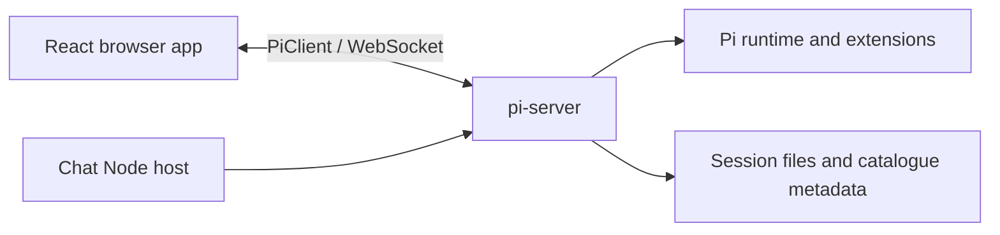

# Architecture

Pi Chat is a browser application and a thin Node host for the independently
packaged Pi server. The server runs Pi sessions; the TypeScript SDK owns the v2
wire contract, transport and synchronized session projections. The browser owns
navigation, drafts, focus and presentation. There is no v1 compatibility path.

## Package boundaries

| Owner | Responsibility |
|---|---|
| [Pi Chat](../src/host/index.ts) | Web assets, `PI_CHAT_*` environment wiring, PID/log/signal lifecycle and build-before-restart policy |
| [pi-server](https://github.com/ManuelSelch/pi-server) | HTTP/WebSocket hosting, controller admission, session/runtime lifecycle, catalogue/persistence, extension registries, file operations and server diagnostics |
| [pi-sdk-typescript](https://github.com/ManuelSelch/pi-sdk-typescript) | Authoritative protocol schemas/artifacts, `PiClient`, request correlation, immutable projections, sequencing and recovery |
| [pi-sdk-swift](https://github.com/ManuelSelch/pi-sdk-swift) | Native client, imported protocol artifacts and Swift-owned real-server compatibility testing |

Chat consumes compiled packages, not sibling sources or a package workspace.
The current manifest and lockfile pin SDK/server 0.2.0 registry releases. See [dependency provenance](../vendor/README.md), rather than inferring
installed behavior from a package version alone. Public server imports are the
root, `/extensions`, `/testing` and `/testing/loopback`; server internals are not
Chat extension points. The SDK's `/protocol` entry is the contract authority.

## Browser composition and state

[App](../src/web/app/App.tsx) composes the controller, confirmations, overlay and
session-action providers, global keyboard routing and responsive workspace.
[Frontend organization](development.md#frontend-organization) describes the six
source owners and their actual dependency boundaries.

[usePiChat](../src/web/app/use-pi-chat.ts) creates one `PiClient` per mounted
controller, supplies the selected endpoint and browser transport, exposes typed
operations and disposes subscriptions/client state on unmount.
[bindPiChat](../src/web/app/connection/sdk-binding.ts) projects SDK state and
notifications into browser-owned views. Chat does not implement another wire
session reducer or request tracker.

- SDK state owns runtime inventory, authoritative session projections, catalogue,
  prompt lists, operation outcomes and runtime theme caches.
- `app/state` owns selection, optimistic opening/closing, dismissed-error masks
  and transient anchored notices. A failed local operation rolls back its local
  placeholder; notices are not persisted transcript messages.
- Navigation and focus are local. Disconnecting or hiding a nonempty conversation
  does not close its runtime. A close operation explicitly tears down a runtime;
  an archive operation changes saved-history metadata.
- Session IDs identify runtime incarnations, not persisted Pi history. Saved
  `sessionPath` is the stable identity for reopening history. See the
  [protocol boundary](protocol.md) for response meanings and uncertain outcomes.

### Conversation input and actions

The server delegates ordinary prompts, slash commands, skills, steering and
user bash to Pi; the browser does not expand resources or schedule model turns.
Queued steering is separate from consumed transcript messages. Snapshots reflect
Pi's current context, so compaction can shorten history. Live/final/snapshot
message identity prevents duplicated history; a reconnect does not promise to
recover an unobserved partial streaming prefix.

[SessionActionsProvider](../src/web/sessions/actions/SessionActionsProvider.tsx)
shares local action definitions and session-scoped errors between composer and
Quick Switcher. Availability and execution guards recheck the current session,
connection and busy state. Menu clearing/dismissal stays with each menu.
Extension commands keep their native Pi path. Restart is available through
Settings and the host command, not session-action menus.

Argument-completion state is composer-local. Requests capture session, draft and
caret context; changing that context aborts/invalidates the local wait. Late
replies cannot insert into another draft. The provider owns filtering and the
replacement value; selecting it inserts without executing.

### Session navigation and drafts

Inbox is enabled by default via browser-local `pi-chat:session-inbox`; an explicit
opt-out retains tabs/Projects navigation. Both modes reuse the same SDK runtimes
and catalogue rather than introducing another server-side session store.

Inbox combines saved, unarchived history with runtime inventory, deduplicated by
session path. Needs you/Working derive from blocked/running status. Ready contains
other idle conversations except browser-local Later membership; it is not an
unread-response list. Loaded rows select a runtime; unloaded rows open saved
history explicitly. History is not reopened automatically.

`sessions/inbox` owns pure row/reconciliation rules, endpoint-scoped Later
storage, lifecycle coordination and component/container UI. Parking loaded saved
idle work stores intent before close; parking unloaded history only stores
membership. Resume removes membership after confirmed opening. Definite failures
roll back; uncertain outcomes reconcile with authoritative inventory/catalogue
without automatic mutation replay. Revision zero is a cold-start catalogue
placeholder, not authoritative empty history. Archive uses server metadata;
success does not create an Undo record or success notice. Notices show errors.

Closing a nonempty view deliberately clears selection and renders Home without
stopping background work. Empty idle runtimes are closed. Removing the selected
runtime during a live connection (including parking or archiving it) also restores
Home rather than selecting another runtime. Background session actions leave the
current selection intact. SDK updates preserve deliberate deselection; runtime
replacement transfers selection, while startup/reconnect retain their existing
selection fallback. Later reconciliation removes missing/archived/external
reopens only after authoritative catalogue availability.

[SessionDraftProvider](../src/web/sessions/drafts/app/SessionDraftProvider.tsx)
owns page-lifetime composer drafts. Unsaved runtime keys transfer to saved paths,
so parking/reopening can reuse drafts even when the runtime ID changes. Browser
reload does not persist these drafts.

Projects navigation groups repository checkouts without mixing their session
identities. Quick Chats stays separate; pins and recent unarchived activity drive
ordering. Worktree labels and catalogue discovery belong to the server/model,
not filesystem probing in views. Inbox uses repository context and promotes a
linked worktree branch above its conversation title; main checkouts retain the
title as primary. Single-conversation linked checkouts omit the subtitle;
multiple conversations retain titles for disambiguation. Counts include unarchived
catalogue history (including Later) and unsaved live siblings, deduplicated against
saved paths before status/search filtering. Later uses the same live inventory.
Rows expose the full title on hover and use suffix-free recency locally; shared
Home/Quick Switcher time formatting is unchanged. Project context uses the
catalogue repository name, falling back to the runtime project name before
discovery. Search/actions continue using original identities.

### Focus and overlays

[AppOverlays](../src/web/app/overlays/AppOverlays.tsx) assembles prompts, session
dialogs, navigation, folders and Settings. Desktop navigation is non-modal;
phone navigation is a modal drawer. Real dialogs retain focus/scroll ownership.
Settings stays mounted while closed so chime playback remains active.

[Composer focus](../src/web/ui/focus/composer-focus.ts) restores only an enabled,
connected, visible composer when no dialog owns focus. Mantine exit callbacks
increment a revision; a layout effect consumes it once after React commits DOM
removal. This is not a polling loop or a promise that an animation frame implies
a commit. Reopening or a newer/nested dialog prevents stale restoration. A
minimized pending prompt can receive focus through its Reopen button while the
composer is disabled. Background stream/snapshot updates do not request focus.
See [focus test discipline](../test/README.md#composer-focus-regressions).

### Runtime prompts, widgets and themes

Server-owned prompts are independent of model turns and survive client reconnect
within their server lifetime. Browser presentation/drafts are keyed by server
instance, runtime and prompt ID; they survive tab changes/reconnects but not page
refresh. Authoritative removal/replacement clears them. Submission guards prevent
duplicate answers; failures retain drafts for retry. Minimize is local and does
not answer, cancel, extend expiry or pause the server's disconnect grace.
[Prompt presentation](../src/web/extensions/prompts/app/use-prompt-presentation.ts)
keeps these drafts out of SDK snapshots.

Widgets carry server-produced ANSI-styled string lines. Chat joins each widget's
lines and renders styled plain text through Fancy-ANSI, not Markdown. HTTP(S)
OSC 8 links open with safe new-tab attributes; Markdown/bare URLs remain literal.
This is not full terminal emulation or comprehensive control-code sanitization.
Widget disclosure is local to each keyed block. Rendering, dock geometry and pure
placement are separate modules. Only above-composer widgets use a container-width
responsive, bottom-aligned grid; below-composer and docked widgets remain stacked.

Theme production belongs to each server runtime. Required open/create palettes
populate the SDK's runtime cache; ordinary snapshots/reload do not refresh it.
Chat maps the selected palette to root Mantine variables, including portals.
Browser-owned remembered appearance is separate from the SDK cache and does not
recolor extension ANSI output. See [theme configuration](configuration.md#pi-themes)
for lifetime, fallback and persistence limits.

### File links and content presentation

Explicit local Markdown-link activation calls the SDK's typed `file.open`, never
a prompt or bash command. Paths belong to the server and resolve against the
specified session's project, not the selected tab at response time. The server
validates readable regular files and uses an injectable, bounded OS opener;
readable paths outside the project are allowed. This is not a project sandbox,
security scan, file download or client-device open operation.

[FileActionsProvider](../src/web/chat/markdown/FileActions.tsx) supplies a stable
callback and bounded, dismissible, expiring failures outside chat history.
Success/cancellation produces no toast. Local cancellation cannot undo an OS
open already accepted by the server. Markdown/read/write previews and edit
highlighting are browser presentation of existing tool content, not new file
access endpoints; raw HTML and remote preview images remain disabled.

## Host lifecycle and security

[The host](../src/host/index.ts) embeds the server with explicit built web assets,
log ownership and idempotent shutdown. Managed PID records are published
atomically. SIGUSR2 invokes the guarded Chat restart policy without acquiring a
WebSocket controller. [Restart service](../src/host/restart-service.ts) resolves
npm from the running Node installation, builds before shutdown and preserves the
current listener on build failure. The extension observes a healthy successor
with a deadline; a disconnect or timeout alone is not proof of restart success.

The server owns Pi runtime construction, including upstream codemode, tool-search
and MCP extension registration. Credentials, subprocesses, discovery/trust and
resource lifecycle remain server/Pi-owned, not browser settings or SDK work.
Server implementation details and profiling diagnostics belong to pi-server;
Chat does not carry a second source inventory or runnable server profiler.

The server can execute tools and access files with its user's permissions. It
has no application authentication; bind to loopback/private interfaces and use a
trusted authenticated TLS proxy/VPN for remote access. Endpoint preferences do
not bypass origin/controller protections. Logs are bounded/redacted and belong
to the host/server; connection diagnostics must not log chat frames or secrets.
See [configuration](configuration.md) and [development](development.md).
