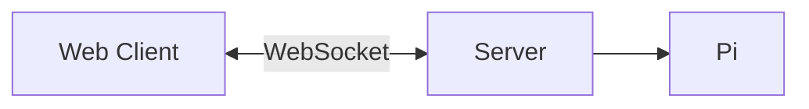
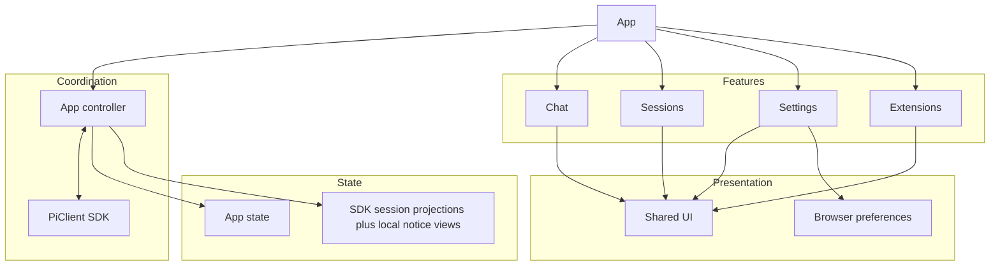
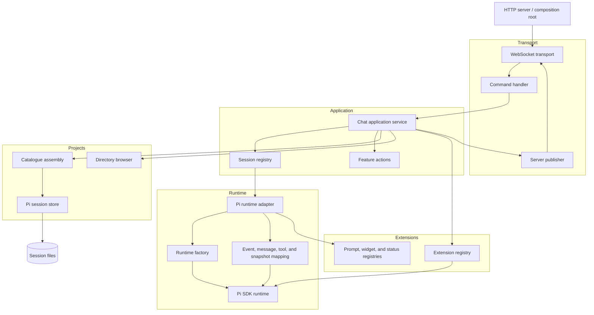

# High-level architecture

Pi Chat is a local web client backed by a server running Pi. The server owns
runtime execution; navigation and focus are application-owned. The coordinated
v2-only protocol and UI-independent TypeScript `PiClient` live in the independent
`pi-sdk-typescript` repository. Chat installs a pinned packed
[`@manuelselch/pi-sdk` artifact](../vendor/README.md); Swift lives in the separate
`pi-sdk-swift` repository. Server and application use the same public
`@manuelselch/pi-sdk/protocol` module. Pi Chat uses one client per mounted
controller: `use-pi-chat.ts` binds its lifecycle/typed operations to React and
`bindPiChat` composes SDK projections with browser-only presentation. No web-owned
wire parser, request trackers or session reducer remain. Slice 5's coordinated
server/SDK/application cutover is complete; there is no live v1 path.

## Web

- `App` mounts the controller; `usePiChat` creates/disposes PiClient and exposes
  typed actions. The browser supplies the explicit endpoint (including the page
  query string) and a logging transport adapter. SDK lifecycle owns backoff,
  takeover, initial-sync timeout, cancellation, request limits and sequencing.
- Chat, Sessions, Settings, and Extensions provide the main web features.
- Shared UI and browser preferences support the features.
- `app/state` composes read-only SDK projections without reducing wire events
  again. It owns transient notification bubbles/anchors, dismissed-error masks,
  optimistic opening/closing placeholders and rollback after local send failures.
  SDK snapshots remain immutable; views accept read-only props. Navigation, input
  drafts and composer focus remain browser-owned. The domain integration driver
  uses the same SDK/view binding, rather than a second WebSocket/reducer path.

## Server

The implementation below belongs to the independent `pi-server` repository, not Chat sources. Chat installs its pinned compiled artifact and owns only `src/host`: environment/static asset wiring, PID/log/signal lifecycle and build-before-restart policy. Root embedding and `/extensions`, `/testing`, `/testing/loopback` are the only supported server imports. See [artifact receipts](../vendor/README.md) and [S4 cutover](pi-server-extraction/S4-CUTOVER.md).

- The HTTP server serves the client and hosts the WebSocket connection.
- Application services manage sessions, projects, actions, and extensions.
- The runtime adapter connects the application to Pi and session files.
