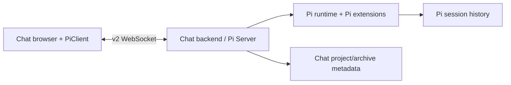

# Architecture map

- Pi Chat is a browser shell over Pi, not a second agent engine.
- Chat backend and Pi Server run in **one Node.js process**. The browser connects over WebSocket; the SDK is a library, not another service.
- Read [core scope](core.md) for capability classification and [architecture details](architecture-details.md) only when a specific behavior needs explanation.

## Boundaries

| Part | Owns | Must not own |
| --- | --- | --- |
| [Chat](../packages/pi-chat/src/web/app/App.tsx) | React composition, navigation, input, rendering | Agent execution or another wire-state reducer |
| [Chat backend](../packages/pi-chat/src/host/index.ts) | Assets, environment, plugin registration, logs/signals/PID lifecycle | A second session engine |
| [TypeScript SDK](../packages/pi-sdk-typescript/src/client.ts) | Protocol validation, requests, reconnect/recovery, synchronized projections | UI focus, navigation or durable history |
| [Pi Server](../packages/pi-server/src/index.ts) | HTTP/WebSocket hosting, live runtimes, catalogue, host plugins | Browser preferences or model/tool implementation |
| [Pi adapter](../packages/pi-server/src/runtime/pi/pi-runtime-adapter.ts) → Pi | Bridge to upstream agent execution, resources and persistence | A Chat-specific model scheduler |
| [Feature plugins](plugins.md) | Their own optional UI/host capability | Global session ownership |

- Chat imports compiled public SDK/Server/plugin exports; private source links below are for reading, not import recommendations.
- Native Pi extensions execute inside session runtimes. Workspace feature plugins are separate, statically registered host/browser capabilities.

## State owners and lifetime

| State | Owner / source of truth | Lifetime |
| --- | --- | --- |
| Agent messages, model execution, steering queue | Pi runtime; Pi session manager persists supported history | Live runtime; saved history survives process restart |
| Live runtime registry | Server [SessionRegistry](../packages/pi-server/src/application/session-registry.ts) | Until explicit runtime close or server shutdown |
| Public runtime IDs, event sequence, catalogue revisions | Server [publisher](../packages/pi-server/src/transport/server-publisher.ts) | Current server/runtime incarnation |
| Saved-session catalogue | Server [ProjectSessionService](../packages/pi-server/src/projects/project-session-service.ts), derived from history/discovery | Rescanned cache, not another transcript store |
| Archive/project metadata | Server [ProjectMetadataStore](../packages/pi-server/src/projects/project-metadata-store.ts) | Separate JSON file on disk |
| Client mirror, pending requests, recovery | SDK [PiClient](../packages/pi-sdk-typescript/src/client.ts) and [session reducer](../packages/pi-sdk-typescript/src/session-state.ts) | Client instance; rebuilt from server state |
| Selected conversation, Home, optimistic navigation, transient notices | Chat [app state](../packages/pi-chat/src/web/app/stores/app-state.ts) | Browser page |
| Composer and question drafts | Chat [session drafts](../packages/pi-chat/src/web/features/sessions/drafts/stores/SessionDraftProvider.tsx) / [prompt presentation](../packages/pi-chat/src/web/features/extensions/prompts/hooks/use-prompt-presentation.ts) | Browser page, not reload |
| Later membership | Chat [Inbox lifecycle](../packages/pi-chat/src/web/features/sessions/inbox/hooks/use-inbox-lifecycle.ts) / [storage](../packages/pi-chat/src/web/features/sessions/inbox/lib/later-storage.ts) | Browser-local, scoped by endpoint |
| Overlay, scroll/focus, widget collapse and panel selection | Owning browser component/provider | Browser page |
| Endpoint, density, Agentation and chime preferences | Browser-local feature storage | Across reloads in this origin/profile |
| Extension questions/widgets/status | Server runtime registries; Chat only presents them | Runtime/interaction lifetime, not permanent transcript |

- `sessionPath` identifies saved history; public `sessionId` identifies a live incarnation. Never persist navigation using a runtime ID as history identity.
- Internal names such as `tabs` still mean open-session inventory; the tab UI has been removed.
- Closing a **view**, closing a **runtime**, parking in **Later** and **archiving** are distinct operations.

## Read the code in this order

### 1. Startup: host first, browser second

1. Optional launcher: [extension/pi-chat.ts](../packages/pi-chat/extension/pi-chat.ts) starts/builds the managed process.
2. [host/index.ts](../packages/pi-chat/src/host/index.ts) registers host plugins, awaits [createPiServer](../packages/pi-server/src/index.ts), then listens. Server readiness does not create an agent by default.
3. [main.tsx](../packages/pi-chat/src/web/app/main.tsx) → [App](../packages/pi-chat/src/web/app/App.tsx) / [AppControllerProvider](../packages/pi-chat/src/web/app/AppControllerContext.tsx) compose React and browser plugins.
4. [usePiChat](../packages/pi-chat/src/web/app/hooks/use-pi-chat.ts) starts one [PiClient](../packages/pi-sdk-typescript/src/client.ts); [transport](../packages/pi-server/src/transport/websocket-transport.ts) initializes it with inventory/snapshots and catalogue state.
5. [bindPiChat](../packages/pi-chat/src/web/app/lib/sdk-binding.ts) → [app reducer](../packages/pi-chat/src/web/app/stores/app-state.ts) builds the visible projection. Catalogue discovery may finish after initial readiness.

### 2. Send a message: command down, events back

1. [ComposerContainer.submit](../packages/pi-chat/src/web/features/chat/composer/components/ComposerContainer.tsx) runs local UI actions locally; other input goes through [usePiChat.prompt](../packages/pi-chat/src/web/app/hooks/use-pi-chat.ts).
2. [PiClient.prompt](../packages/pi-sdk-typescript/src/client.ts) sends `message.send`; [V2Connection](../packages/pi-server/src/transport/v2-connection.ts) / [executeOperation](../packages/pi-server/src/transport/command-handler.ts) validate/admit it and return an acceptance receipt.
3. [ChatApplicationService.prompt](../packages/pi-server/src/application/chat-application-service.ts) locates/guards the runtime; [PiRuntimeAdapter.prompt](../packages/pi-server/src/runtime/pi/pi-runtime-adapter.ts) delegates to Pi. Pi owns tools and steering; the adapter bridges bash/native commands.
4. [Event mapping](../packages/pi-server/src/runtime/pi/event-mapping.ts) → application subscription → [ServerPublisher](../packages/pi-server/src/transport/server-publisher.ts) emits sequenced events; completion also refreshes snapshots/catalogue.
5. SDK [session state](../packages/pi-sdk-typescript/src/session-state.ts) reduces events → browser binding/app projection → [MessageListContainer](../packages/pi-chat/src/web/features/chat/transcript/components/MessageListContainer.tsx) renders. Acceptance is not turn completion.

### 3. Reopen history: saved path becomes a runtime

1. [Inbox lifecycle.select/resume](../packages/pi-chat/src/web/features/sessions/inbox/hooks/use-inbox-lifecycle.ts) or [QuickOpenContainer](../packages/pi-chat/src/web/features/sessions/quick-open/components/QuickOpenContainer.tsx) chooses a saved path. A live row only focuses its existing runtime.
2. [PiClient.openSession](../packages/pi-sdk-typescript/src/client.ts) sends `session.open` → [executeOperation](../packages/pi-server/src/transport/command-handler.ts) → [ChatApplicationService.openSession](../packages/pi-server/src/application/chat-application-service.ts).
3. The application reuses an already-open path and coalesces concurrent opens; otherwise [PiRuntimeAdapter.openSession](../packages/pi-server/src/runtime/pi/pi-runtime-adapter.ts) uses Pi's `SessionManager.open` and [runtime factory](../packages/pi-server/src/runtime/pi/runtime-factory.ts).
4. [Publisher.opened](../packages/pi-server/src/transport/server-publisher.ts) returns summary, snapshot and theme with a public incarnation ID; SDK applies them before resolving.
5. Chat focuses that ID. Resume clears Later only after confirmed opening; page-lifetime drafts reconnect by saved path.

## Rules worth remembering

- Disconnecting a browser does not close agent runtimes; reconnect resynchronizes rather than replaying mutations.
- SDK snapshots/events own wire state. Chat's reducer adds presentation, not a competing protocol implementation.
- Preserve definite-failure rollback and uncertain-outcome handling; timeouts do not prove the server did nothing.
- The server has no application authentication. Use loopback or a trusted authenticated proxy/VPN; Pi runs with the host user's permissions.
- Further reading: [protocol](protocol.md), [Server internals](../packages/pi-server/docs/ARCHITECTURE.md), [behavior/lifetime details](architecture-details.md), [usage](../packages/pi-chat/docs/usage.md).
