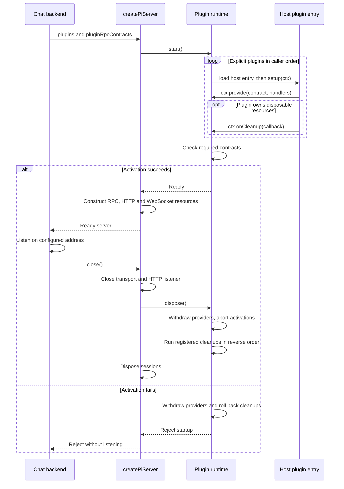

# Plugin host integration

## Host lifecycle

- Activation and RPC exposure are separate: a registered provider is remotely callable only when its contract is allowlisted.
- Host activation is server-scoped, not session-scoped. [Folder-opening RPC](../plugins/folder-opening/docs/architecture.md#browsing-over-rpc) shows invocation after readiness.

## Integration details

- [Chat backend](../packages/pi-chat/src/host/index.ts) awaits `createPiServer` before installing routes or listening.
- Pi Server accepts explicit `plugins`, activates host entries once per server instance and resolves after readiness. It activates no defaults; Chat registers the file-opening, folder-opening and diff-viewer providers.
- Startup precedes HTTP/WebSocket construction; failure rolls back rather than exposing a partially ready server. Server actions are available after readiness, not during setup.
- Server close owns transport, plugin and session teardown; Chat owns its injected logger, signals and PID records.
- Session-level Pi extensions remain distinct from server-scoped plugin activation.
- Host runtime implementation/tests belong to [Pi Server](../packages/pi-server/README.md), not Chat. See its [lifecycle guide](../packages/pi-server/docs/PLUGINS.md).
- Chat passes `fileOpeningContract`, `folderOpeningContract` and `diffViewerContract` in `pluginRpcContracts`. Negotiated, server-scoped `plugin.call` uses `/ws`; only allowlisted contracts/revisions/methods are callable. Provider validation and sanitized RPC errors remain Server-owned.
- `AppControllerProvider` composes the browser [file-opening entry](../plugins/file-opening/src/web/index.ts) with the generic request boundary from `usePiChat`. File policies and OS behavior are documented [with the feature](../plugins/file-opening/README.md).
- Folder browsing uses one package import with [runtime-specific folder-opening definitions](../plugins/folder-opening/docs/architecture.md#loading-and-injection): Node resolves the host provider; the browser resolves only UI contributions before rendering. RPC exposure remains explicitly allowlisted; Chat supplies generic session creation/navigation and focus capabilities; the plugin owns picker state and contributes its UI through the [browser composition](plugins.md#browser-contributions). Browsing errors remain actionable and requests can be cancelled locally.
- Browser startup loads only web entries from the explicit plugin list; it never activates host entries. No push subscriptions or dynamic installation are wired into Chat.
