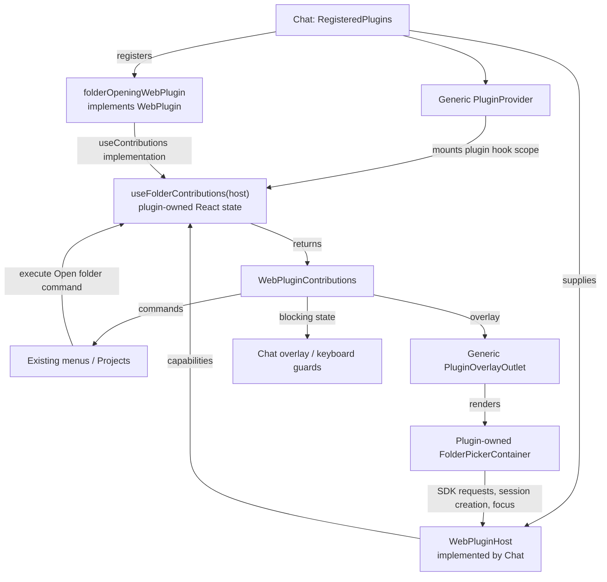

# Plugin boundaries

- SDK owns generic declarations and typed client transport; Server owns host activation and RPC dispatch.
- Feature packages own contracts, browser UI/client and host handlers. Chat supplies shell capabilities, not feature state.
- [Host integration](plugin-runtime.md), [SDK contracts](../packages/pi-sdk-typescript/docs/PLUGINS.md) and [Server lifecycle](../packages/pi-server/docs/PLUGINS.md) describe the non-UI boundaries.

## Browser contributions

- [WebPlugin](../packages/pi-sdk-typescript/src/plugins/web-plugin.ts) defines the plugin ID and contribution hook; `WebPluginHost` defines capabilities supplied by Chat, not access to its controller.
- [useFolderContributions](../plugins/folder-opening/src/web/hooks/use-folder-contributions.tsx) implements that hook and owns `opened` state. Its `WebPluginContributions<ReactNode>` result contains commands, the picker overlay and blocking state.

- [RegisteredPlugins](../packages/pi-chat/src/web/app/plugins/RegisteredPlugins.tsx) is Chat's explicit browser registration list and host adapter.
- [PluginProvider](../packages/pi-chat/src/web/app/plugins/PluginProvider.tsx) mounts a keyed React hook scope per plugin. Its contributions are commands, an optional overlay and blocking-focus state.
- Plugin hooks own feature state; removing a registration unmounts its scope, runs React cleanup and withdraws its commands/overlay.
- Command IDs use the plugin namespace. Menus and Projects consume placement-filtered contributions; execution resolves the current command and rechecks its disabled state.
- The generic overlay outlet renders contributed React nodes. Dialogs use host-provided focus-return handling; blocking contributions participate in Chat's overlay/keyboard guard. Exiting dialogs retain DOM focus ownership until removal.
- Host capabilities expose reactive connection/project context, a request boundary resolving the current SDK client, session creation/navigation and a stable modal-focus hook. Plugins never resolve Chat's controller or stores.
- Contributions are published after each plugin commit. Definitions and host hook implementations remain stable for a registration's lifetime; hooks run only in their mounted React scopes.
- No dynamic loader, installation, arbitrary UI slots or browser event-hook framework is implemented. Pi runtime extensions remain separate.

## Features

- [Folder opening](../plugins/folder-opening/docs/architecture.md) registers `folder-opening.open` in menus and Projects and contributes its complete picker. Dialog state, container, browsing client and error handling stay in the plugin.
- Chat has no folder picker overlay field or folder RPC methods in its controller. Session creation remains a generic shell action.
- [File opening](../packages/pi-chat/src/plugins/file-opening/index.ts) retains its existing app-composed browser actions; it is not migrated to the UI contribution API by this change.
- Host plugins and RPC allowlists remain explicitly configured separately from browser registrations. Removing browser UI does not disable server capabilities.
- Server-sent declarative buttons/badges and Pi prompts/widgets are separate presentation mechanisms, not executable browser plugins.
