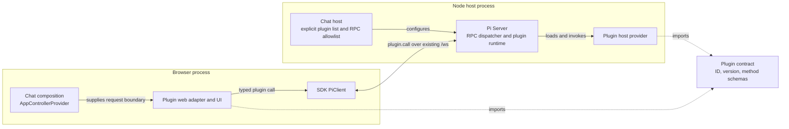

# Plugin boundaries

## Runtime boundaries

- Solid arrows show composition or runtime calls; dotted arrows show shared contract imports.
- SDK owns generic declarations/client transport; Server owns host activation and dispatch. Feature code owns its contract and handlers.
- Browser adapters are still explicitly composed by Chat, not activated by a generic web registry. [Folder-opening wiring](../plugins/folder-opening/docs/architecture.md) shows the concrete path.

## Ownership

- Shared declarations come from `@manuelselch/pi-sdk/plugins`; Chat owns no copy of the primitives or host runtime.
- The SDK's `/plugins/file-opening` entry owns the file contract. The independent [folder-opening workspace](../plugins/folder-opening/README.md) owns its contract, browser UI/client and host filesystem logic.
- Pi Server owns `createPluginRuntime` under `@manuelselch/pi-server/plugins` and manages it through async server creation/close.
- Chat explicitly activates and allowlists Server's file-opening provider and the standalone folder-opening provider. Typed `plugin.call` RPC uses the existing WebSocket.
- The [file-opening entry](../packages/pi-chat/src/plugins/file-opening/index.ts) composes browser actions in `AppControllerProvider`; `usePiChat` owns only the generic SDK connection/request boundary. Feature-specific duplicate-click and runtime-removal policies are not required plugin boilerplate.
- [Host integration](plugin-runtime.md) covers Chat's startup boundary; detailed contracts/lifecycle live in the [SDK guide](../packages/pi-sdk-typescript/docs/PLUGINS.md) and [Server guide](../packages/pi-server/docs/PLUGINS.md).
- Package ownership, local linking and imported history are recorded in the [monorepo guide](monorepo.md).
- The [folder-opening entry](../plugins/folder-opening/src/web/index.ts) owns the picker and browsing client; Chat supplies the session-creation action and overlay state. The picker retains its existing layout and behavior.
- Web plugin activation and dynamic installation remain unimplemented; browser entries are app-composed.
