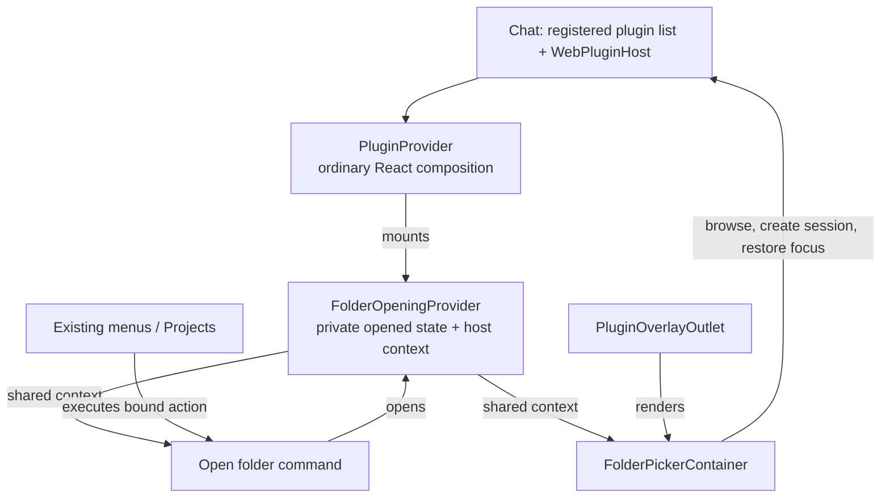

# Plugin boundaries

- SDK owns declarations and typed client transport; Server owns host activation and RPC dispatch.
- Feature packages own contracts, UI and host handlers. Chat supplies shell capabilities, not feature state.
- [Host integration](plugin-runtime.md), [SDK contracts](../packages/pi-sdk-typescript/docs/PLUGINS.md) and [Server lifecycle](../packages/pi-server/docs/PLUGINS.md) cover the non-UI boundaries.

## Browser contributions

A [WebPlugin](../packages/pi-sdk-typescript/src/plugins/web-plugin.ts) declares a **Provider**, static **commands**, an **Overlay** component and an overlay-open hook.

- [RegisteredPlugins](../packages/pi-chat/src/web/app/plugins/RegisteredPlugins.tsx) supplies the explicit list and `WebPluginHost`: connection/project context, current-client requests, session creation/navigation and shared modal focus handling.
- [PluginProvider](../packages/pi-chat/src/web/app/plugins/PluginProvider.tsx) nests the registered providers. Small context bindings read command actions and overlay-open state inside those providers; nothing is published or synchronized through effects.
- Static command definitions contain namespaced IDs, labels, placements and an action hook reading plugin-local context. Menus/Projects receive ordinary actions, including their current disabled state.
- The outlet mounts each plugin's Overlay component. Overlay-open hooks feed generic keyboard/focus guards; exiting dialogs retain DOM focus ownership until removal.
- Registration is static application composition, not an install/uninstall API. Changing provider ancestry follows normal React remount rules; callbacks are ordinary render-bound handlers, not persistent command handles.
- No contribution registry state, effect-based registration, stale-callback dispatcher, dynamic loader or browser event-hook framework is needed. Memoization only avoids unrelated shell/list rerenders; correctness does not depend on it.

## Features

- [Folder opening](../plugins/folder-opening/docs/architecture.md) registers `folder-opening.open`. [FolderOpeningProvider](../plugins/folder-opening/src/web/stores/FolderOpeningProvider.tsx) owns dialog state; the command and picker read the same private context.
- The plugin owns its container, browsing client and error handling. Chat has no picker import, feature overlay field or folder RPC methods.
- [File opening](../packages/pi-chat/src/plugins/file-opening/index.ts) retains its existing app-composed browser actions.
- Host plugins and RPC allowlists are configured separately. Browser composition does not activate or disable server capabilities.
- Pi runtime extensions and server-sent buttons/badges, prompts and widgets remain separate mechanisms.
