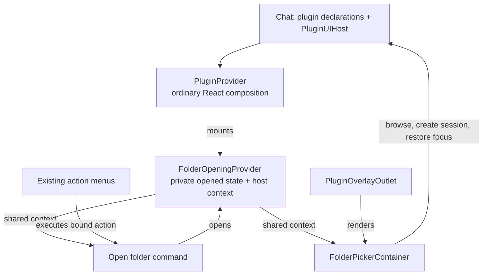

# Plugin boundaries

- SDK owns declarations and typed client transport; Server owns host activation and RPC dispatch.
- Feature packages own contracts, UI and host handlers. Chat supplies shell capabilities, not feature state.
- [Plugin development tooling](plugin-development.md) shares build/test defaults while preserving package-local dependencies, exports and behavioral tests.
- [Host integration](plugin-runtime.md), [SDK contracts](../packages/pi-sdk-typescript/docs/PLUGINS.md) and [Server lifecycle](../packages/pi-server/docs/PLUGINS.md) cover the non-UI boundaries.

## Browser contributions

- [Plugin](../packages/pi-sdk-typescript/src/plugins/plugin.ts) is the SDK declaration for host and UI entry loaders, which may return values or promises. Defining a plugin does not invoke its loaders. Its web loader returns UI contributions without a second ID, rather than imperative setup.
- [PluginUI](../packages/pi-sdk-typescript/src/plugins/plugin-ui.ts) declares a **Provider** and optional static **commands**, placed UI **contributions**, an **Overlay** component and an overlay-open hook. Settings-only plugins omit commands and overlays. It has no identity of its own.
- [loadPluginUIs](../packages/pi-chat/src/web/app/plugins/load-plugin-ui.ts) loads explicit declarations before the first app render, retaining `{ id, ui }` for composition. It skips host-only entries, preserves order and rejects duplicate IDs before loading. After loading, it validates command/contribution namespaces, uniqueness and supported placements once per composition, not on host-data renders. Load/validation failures reject startup rather than silently dropping contributions.

- [RegisteredPlugins](../packages/pi-chat/src/web/app/plugins/RegisteredPlugins.tsx) loads the explicit declarations and supplies `PluginUIHost`: read-only session ID/status summaries, connection/project context, current-client requests, session creation/navigation and shared modal focus handling.
- [PluginProvider](../packages/pi-chat/src/web/app/plugins/PluginProvider.tsx) nests the registered providers. Small context bindings read command actions and overlay-open state inside those providers; nothing is published or synchronized through effects.
- Static command definitions contain namespaced IDs, labels, placements and an action hook reading plugin-local context. Current action menus receive ordinary actions, including disabled state. The declaration still permits `projects`, but its legacy Projects UI consumer has been retired.
- The outlet mounts each plugin's Overlay component. Overlay-open hooks feed generic keyboard/focus guards; exiting dialogs retain DOM focus ownership until removal.
- Registration is static application composition, not an install/uninstall API. Changing provider ancestry follows normal React remount rules; callbacks are ordinary render-bound handlers, not persistent command handles.
- No contribution registry state, effect-based registration, stale-callback dispatcher, dynamic installation or browser event-hook framework is needed. Memoization only avoids unrelated shell/list rerenders; correctness does not depend on it.

## Settings contributions

- `PluginUI.contributions` declares `{ id, placement, Component }`. IDs belong to the plugin namespace; placement names belong to the host. Settings uses `settings.feature-toggles`; side-panel tabs use the separate placement below.
- `loadPluginUIs` rejects duplicate/out-of-namespace contribution IDs and unsupported placements before mounting. `PluginUIOutlet` renders matching components in declaration order beneath the same plugin providers, with host-owned spacing.
- Settings passes the generic outlet into the existing Feature Toggles section; it has no plugin-specific props, state, labels or persistence. Omitting a plugin removes its controls. No imperative registration or effect-synchronized registry is involved.
- Providers own page-lifetime effects and preferences independently of contributed controls mounting/unmounting. Plugins may persist their own preferences; no generic settings database or server setting is introduced.

## Side-panel contributions

- `PluginUI.contributions` with `placement: "side-panel"` requires a label and an `Icon` component as well as ID/content. An optional `available({ view })` predicate restricts availability to Home or transcript; absent predicates are always available. IDs remain plugin-namespaced; startup validates required metadata.
- [SidePanelProvider](../packages/pi-chat/src/web/app/plugins/SidePanelProvider.tsx) filters tabs by view and owns a neutral header toggle, open state and active tab. Closing or losing all available tabs unmounts content; provider-owned preferences remain. The panel stays closed when tabs become available again. No modal focus trap or global keyboard blocker is added.
- Chat reserves panel width for the transcript, fixed composer and widget gutters. The panel uses 46% of the available workspace; below 760px available it replaces chat and composer within the workspace, retaining navigation and the chat draft.
- The shell knows no Git methods or diff state. Omitting all panel contributions removes the toggle; adding another tab needs no feature-specific shell button.
- Browser consumers must scan contributed Tailwind classes; Chat explicitly scans the diff-viewer’s compiled web entry in its stylesheet, after the plugin build.

## Features

- [Folder opening](../plugins/folder-opening/docs/architecture.md) registers `folder-opening.open`. [FolderOpeningProvider](../plugins/folder-opening/src/web/stores/FolderOpeningProvider.tsx) owns dialog state; the command and picker read the same private context.
- The plugin owns its container, browsing client and error handling. Chat has no picker import, feature overlay field or folder RPC methods.
- [File opening](../plugins/file-opening/README.md) owns its contract, browser actions and host/filesystem implementation in a standalone workspace; Chat explicitly composes `createFileOpeningActions(request)` rather than registering an empty browser provider.
- [Chimes](../plugins/chimes/README.md) contributes `chimes.enabled` at `settings.feature-toggles`; its provider owns browser-local preferences, transition tracking and audio cleanup independently of Settings visibility.
- [Diff viewer](../plugins/diff-viewer/README.md) contributes `diff-viewer.changes` at `side-panel` only in transcript view; its package owns Git reads, comparison selection and the continuous diff/file navigation. [Browser scenario](../packages/pi-chat/testing/e2e/diff-viewer.spec.ts) exercises real Git/RPC alongside chat.
- Host plugins and RPC allowlists are configured separately. Browser composition does not activate or disable server capabilities.
- Native Pi prompts, widgets and footer status remain separate from browser plugin contributions.
