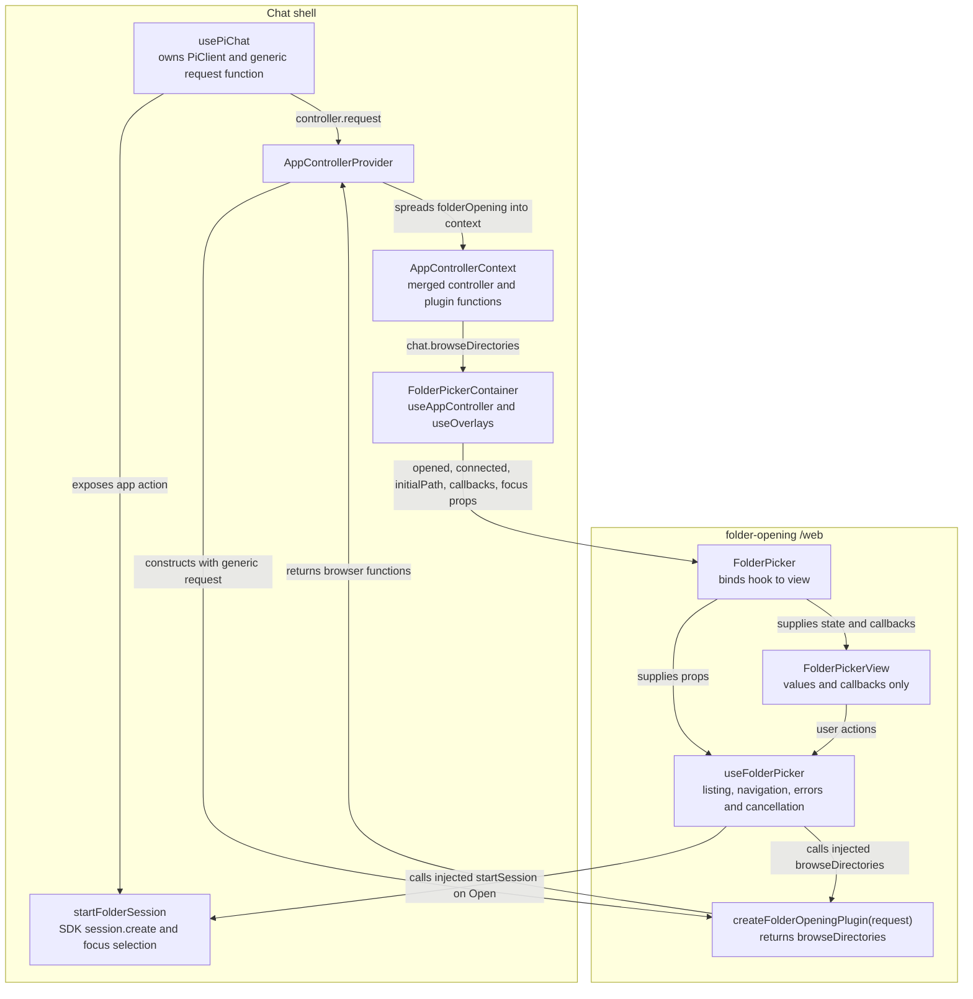
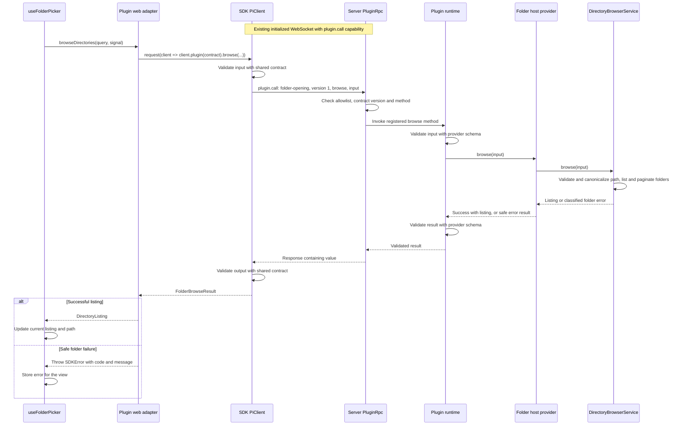

# Folder-opening architecture

- Package entries: root = contract/types, `/web` = browser adapter/picker, `/host` = provider/filesystem service.
- [General boundaries](../../../docs/plugins.md) and [host lifecycle](../../../docs/plugin-runtime.md) describe the shared infrastructure.

## Browser composition

- `browseDirectories` is created by the plugin adapter, merged into Chat's context, then passed through the picker props to the hook. The hook does not resolve Chat services.
- `startSession` is a separate app callback, not a method on the folder RPC contract. A successful start closes the picker; a failed start leaves an actionable error.
- The hook aborts outdated local waits and ignores stale results. This does not cancel filesystem work remotely.

## Browsing over RPC

- Contract and [named result schemas](../src/schemas.ts) are shared by browser and host. The host omits absent optional fields so results remain JSON-safe.
- Expected filesystem failures become safe error results. Unexpected filesystem exceptions become a generic `operationFailed` result; dispatcher/validation failures become RPC rejections.
- Server also imports this plugin's directory service for existing `directory.browse` and session-path validation; those paths do not activate or call the folder plugin RPC.
